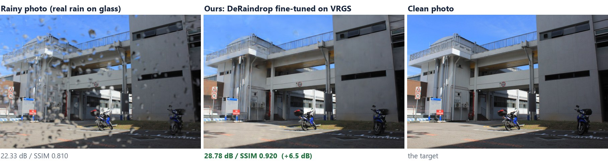
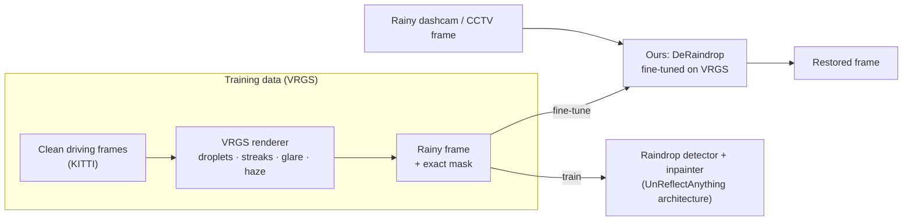
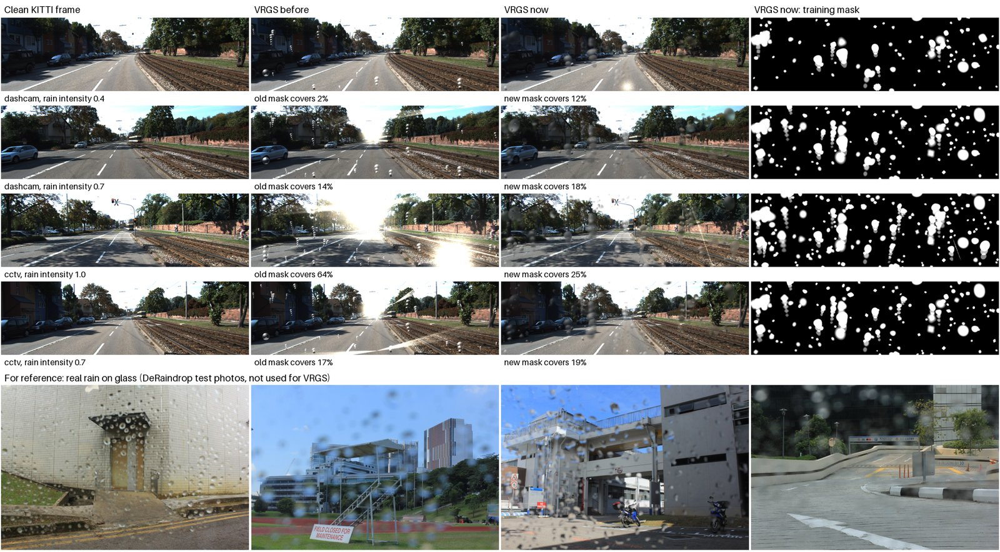
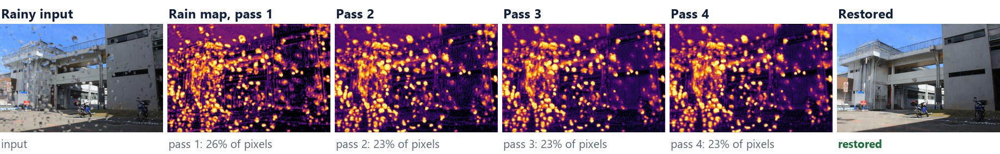
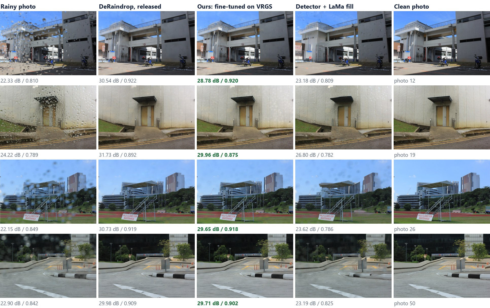
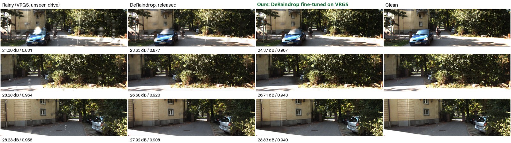
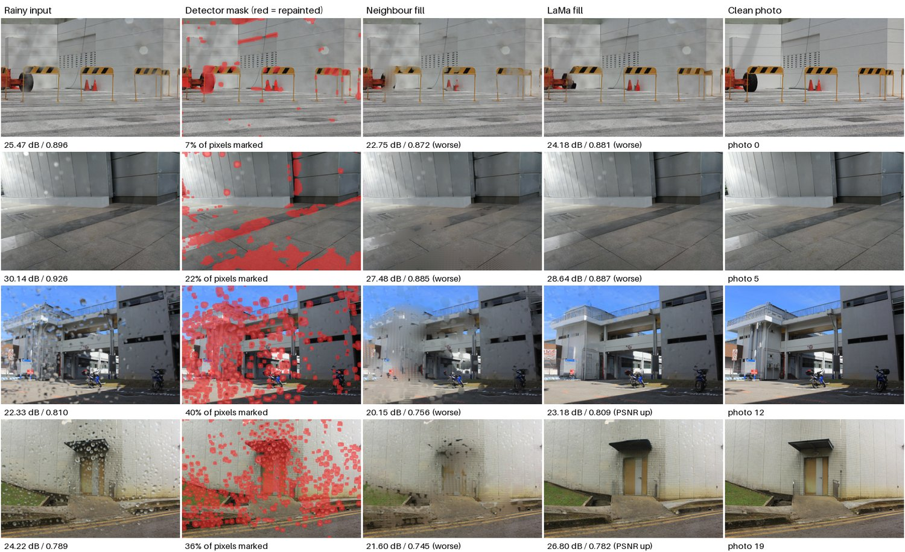
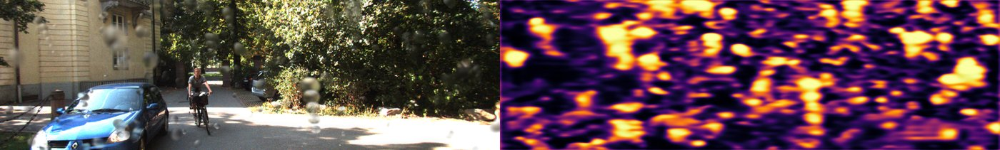
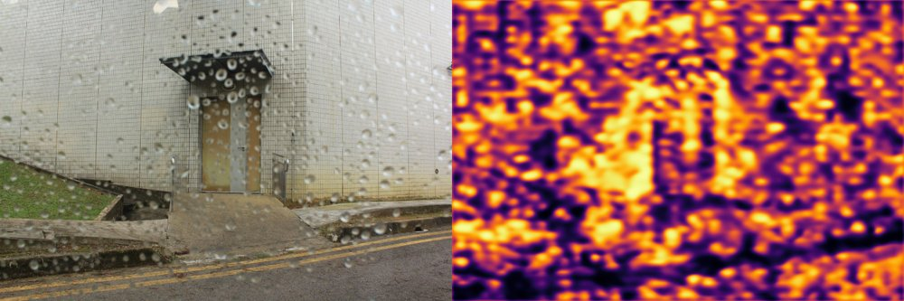
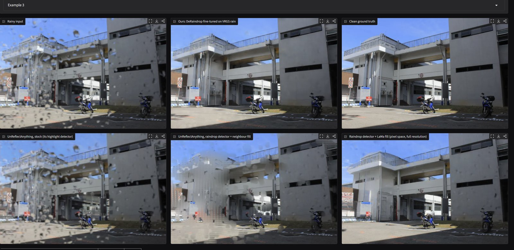

# Seeing Through Wet Lenses

**Synthetic Rain and Instance-Aware Repair for Dashcam and CCTV**




## Abstract

We remove raindrops, streaks and glare from dashcam and CCTV footage, which never has clean reference frames. We
introduce VRGS, a procedural renderer that synthesises water-on-glass degradations with exact masks, and use it to
fine-tune DeRaindrop, which then improves 7 of 18 held-out dashcam frames (the released model: none). An
instance-segmentation pipeline (Flare7K++, YOLO11-seg, SAM 3) then finds each glare, streak, raindrop, vehicle and
wet-road region and repairs it with a suitable model. It matches the fine-tuned model on 58 real photos (30.1 dB,
SSIM 0.912) while visibly removing more night glare from CCTV.

When it rains, water sits on the camera's own glass: the windshield in front of a dashcam, or the dome of a CCTV
camera. Drops blur and warp the scene behind them, sliding drops leave streaks, and headlights flare through the wet
glass, exactly when the footage matters most (accidents, number plates, surveillance in bad weather). This project
restores a single rainy frame.

Real rainy and clean footage from the same camera barely exists, so the models learn from **VRGS**, our renderer for
synthetic rain on glass.

## Highlights

- **VRGS, a rain-on-glass renderer.** It draws see-through, out-of-focus drops, sliding streaks, glare and haze onto
  ordinary driving footage, and outputs an exact mask of every changed pixel.
- **Training on VRGS makes a raindrop model work on dashcam/CCTV rain.** The released DeRaindrop model improves
  **0 of 18** frames of an unseen drive. Fine-tuned on VRGS for 30 minutes, it improves **7 of 18**, and still
  improves **all 58** real test photos.
- **Instance-aware repair.** [segment_repair.py](segment_repair.py) finds every glare, streak, raindrop, person,
  vehicle and wet-road region as its own instance (Flare7K++, our DeRaindrop, YOLO11-seg, SAM 3 text prompts) and
  repairs each with the model that suits it: glare removed, streaks dimmed, the wet road and its reflections kept.
  It scores 30.08 dB / SSIM 0.912 on the 58 real photos, level with the fine-tune alone (30.11 / 0.912).
- **A diagnosed failure in the base model.** UnReflectAnything's released inpainter was trained with an inverted mask,
  so on raindrops it darkens drops instead of removing them.
- **Fast enough to use.** 0.87 s per image on a laptop RTX 4060 (52.9 s on a laptop CPU). VRGS renders 10–18× faster
  than its first version.
- **A live demo** that adds rain, runs the models stage by stage, and compares every method.

## Contents

- [Abstract](#abstract)
- [The problem](#the-problem)
- [How it works](#how-it-works)
- [Results](#results)
- [What we learned](#what-we-learned)
- [Efficiency](#efficiency)
- [Live demo](#live-demo)
- [Getting started](#getting-started)
- [Repository layout](#repository-layout)
- [Roadmap](#roadmap)
- [Credits](#credits)

## The problem

| Artifact | What it does to the image |
|---|---|
| **Droplets** | Each drop is a tiny lens: it shows a blurred, shrunken, upside-down view of the scene and hides what's behind it |
| **Streaks** | Drops slide under gravity, wind or the car's motion and leave trails |
| **Glare** | Headlights and streetlights bloom and smear through the wet glass |

This is different from removing *falling* rain, the usual "deraining" problem. Here the water is on the lens: close to
the camera, out of focus, and it stays put while the scene moves. Existing raindrop models learn from a few thousand
photos taken through one glass pane, and none of them treat droplets, streaks and glare together for dashcams and
CCTV.

## How it works



### VRGS: synthetic rain on glass

[raindrop_render.py](raindrop_render.py) is a procedural renderer with no learned weights. It draws rain onto clean
KITTI driving frames:

- **Droplets.** Each drop refracts a shrunken, upside-down view of the scene. Drops are out of focus, mostly
  see-through and irregular (rotated ellipses with wobbly edges), and come in many sizes. Each one has its own opacity,
  rim, blur and edge softness.
- **Streaks.** Larger drops slide, all in one wind direction per frame: angled for a moving dashcam, straight down for
  a static CCTV camera.
- **Glare.** Real light-streak shapes from Flare7K, placed where the scene already has bright lights.
- **Haze.** A thin wet-glass veil over the whole frame.
- **An exact mask.** Every frame comes with a mask of the pixels the rain changed, which is the detector's training
  target.


*Clean frame, the first version of VRGS (drops like glass marbles, glare covering up to 64% of a frame), the current
version and its training mask. The bottom row is real rain on glass, for reference.*

### The models

| Model | How it works | Status |
|---|---|---|
| **Ours: DeRaindrop fine-tuned on VRGS** | A recurrent attention network finds the rain over 4 passes, then an autoencoder restores the scene behind it ([derainnet.py](derainnet.py), [finetune_deraindrop.py](finetune_deraindrop.py)) | **Best model.** Fine-tuned 30 min on a GPU, on VRGS plus real DeRaindrop pairs |
| Detect-and-repair pipeline | Raindrop detector → DINOv3-L encoder (frozen) → choose patches → repair → DPT decoder; pixels outside the repairs are kept ([model_stages.py](model_stages.py)) | Repair with **neighbour fill** or **LaMa**. Our own detector and inpainter had a first 1-hour training run |


*Our model on a real photo: the raindrop map after each of the four attention passes, then the restoration, which
recovers the scene behind the water.*

The detect-and-repair pipeline adapts **UnReflectAnything** (Rota et al., CVPR 2026), a specular-highlight remover
that also learns from synthetic data:

- **Detector.** Its highlight detector looks for bright spots, not rain, so the pipeline uses DeRaindrop's attention
  network or our own detector trained on VRGS masks.
- **Repair step.**
  - **The released inpainter isn't used.** It was trained with an inverted mask: at each hole it sees the hole's own
    features and corrects them in place, so on rain it darkens each drop instead of removing it.
  - **Neighbour fill** rebuilds each marked patch from the clean patches around it, with no learned weights.
  - **LaMa** (a pretrained inpainting model) repaints the marked pixels at full resolution.

## Results

**Test sets:**
- **Real rain:** all 58 photos of DeRaindrop's test set A, each with a clean photo of the same scene.
- **Dashcam/CCTV rain:** VRGS rain on 18 frames of a KITTI drive that no model was trained on.

Scores are PSNR (dB) / SSIM against the clean image (higher is better). The last number in each cell is how many
images the method improves on **both** metrics compared with leaving the frame alone
([eval_all.py](eval_all.py), [eval_results/all_methods.json](eval_results/all_methods.json)).

| Method | Real photos (58) | Dashcam/CCTV, unseen drive (18) |
|---|---|---|
| Rainy input, left alone | 23.81 / 0.847 | 25.41 / 0.928 |
| UnReflectAnything, stock | 19.14 / 0.753, 0 | 15.87 / 0.731, 0 |
| DeRaindrop detector + neighbour fill | 22.30 / 0.787, 2 | 19.84 / 0.822, 0 |
| DeRaindrop detector + LaMa | 24.94 / 0.825, 11 | 20.27 / 0.816, 0 |
| DeRaindrop, released (CVPR 2018) | **30.93** / 0.911, 57 | 25.78 / 0.898, **0** |
| **Ours: DeRaindrop fine-tuned on VRGS** | 30.11 / **0.912**, **58** | **26.29 / 0.923, 7** |
| Our VRGS-trained detector + LaMa (experimental) | 23.59 / 0.761, 0 | 23.15 / 0.859, 0 |
| Our VRGS-trained detector + its own inpainter (experimental) | 16.46 / 0.620, 0 | 19.02 / 0.789, 0 |


*Real rain. The released DeRaindrop scores highest here, because these photos come from its own capture rig. Ours
stays close to it, and both are far ahead of the repaint pipelines.*


*Dashcam/CCTV rain on a drive no model was trained on. The released DeRaindrop leaves streaks and glare and softens
the frame. Ours removes more of them and keeps the scene sharper.*

How the fine-tune developed ([eval_results/deraindrop_vrgs_finetune.json](eval_results/deraindrop_vrgs_finetune.json)):

| | Dashcam/CCTV, unseen drive (18) | Real photos (58) |
|---|---|---|
| DeRaindrop, released | 25.78 / 0.898, 0 of 18 | 30.93 / 0.911, 57 of 58 |
| Fine-tuned, first version (CPU, 20 min, old VRGS) | 25.46 / 0.901, 0 of 18 | 30.66 / 0.912, 58 of 58 |
| **Fine-tuned (GPU, 30 min, current VRGS)** | **26.29 / 0.923, 7 of 18** | 30.11 / **0.912**, **58 of 58** |

## What we learned

1. **VRGS works as training data for dashcam rain.** Fine-tuning on it turns DeRaindrop from improving none of the
   dashcam/CCTV frames into improving 7 of 18, while it still improves every real photo. The cost: 0.8 dB PSNR on
   the real photos, with SSIM unchanged. A lower learning rate should recover it.

2. **Restoring beats repainting.** Water on glass is mostly see-through, so the scene behind a drop is still partly
   visible. Every pipeline that throws a drop's pixels away and paints new ones scores below the untouched frame.
   Even LaMa with the true droplet mask improves only 3 of 8 photos. Models that restore (like DeRaindrop) win.

   
   *Repainting what the detector marks (red). Neighbour fill smears; LaMa rebuilds structure but repaints clean areas
   too, because the detector marks about 24% of pixels where real drops cover about 13%.*

3. **Our VRGS-trained detector finds synthetic rain better than DeRaindrop's,** with mask overlap (IoU) of 0.53 vs
   0.42 on the unseen drive, but **it doesn't transfer to real photos yet**. Real close-up drops are sharper and more
   in focus than VRGS renders, which is the next thing to add to VRGS.

   
   
   *Top: our detector's rain map on VRGS rain from the unseen drive. Bottom: on a real photo it fires everywhere.*

4. **Our own inpainter needs far more training.** One hour from scratch on an 8 GB laptop GPU fills holes with flat
   grey. The original paper trains for 20 epochs at 896 px on large datasets.

## Efficiency

On a laptop CPU (Intel Core i7-1065G7, 16 GB RAM, batch size 1;
[benchmark_efficiency.py](benchmark_efficiency.py), [eval_results/efficiency.json](eval_results/efficiency.json)):

| | Parameters | FLOPs / image | Latency | Throughput |
|---|---|---|---|---|
| Stock UnReflectAnything | 498 M | ≈5.5 T | 78.7 s | 0.76 img/min |
| Detect-and-repair pipeline (neighbour fill) | 408 M | ≈4.2 T | 52.9 s | 1.13 img/min |
| DeRaindrop (ours is the same network) | 6.2 M | 0.81 T | 10.8 s | 5.5 img/min |
| VRGS renderer, first version (per 960×290 frame) | none | – | 6.6 s | 9.1 frames/min |

- **On a laptop GPU** (NVIDIA RTX 4060, 8 GB), the pipeline takes **0.87 s** per image, about 60× faster, with
  5.4 GB peak VRAM.
- **Our model is small.** DeRaindrop fine-tuned on VRGS runs in about **8 s on the CPU**, with only 6.2 M parameters.
- **The current VRGS** renders each droplet on a crop around itself, which makes it 10–18× faster on the CPU. A
  pre-rendered cache keeps training from waiting on it.
- **The frozen DINOv3 encoder** is 61% of the pipeline's CPU latency.

## Live demo



`run_demo.bat` (or `python demo_app.py`) opens a Gradio app at http://127.0.0.1:7860. It has three tabs:

| Tab | What it shows |
|---|---|
| **Add rain (VRGS)** | Adds rain to a clean frame live (dashcam or CCTV, adjustable intensity) and shows the training mask. Runs either DeRaindrop version on the result. |
| **Watch the model, step by step** | Runs a model stage by stage on a rainy photo, showing each stage's image as it finishes, then scores the result against the clean photo. The default is ours (about 8 s on a CPU). |
| **Remove rain: results** | Every method side by side on real rainy photos, with scores; instant, since outputs are precomputed. |

The demo opens on photo 12 (set `DEMO_PHOTO` to choose another). It uses the GPU when there is one; on a CPU, start
it a couple of minutes early so the models can load. It needs about 6–8 GB of RAM.

## Getting started

### 1. Install

Windows with Python 3.12:

```bat
git clone https://github.com/VyaanSachdeva/rain-on-glass.git
cd rain-on-glass
py -3.12 -m venv .venv
.venv\Scripts\activate
rem PyTorch first (pick one):
pip install torch==2.9.1 torchvision==0.24.1
pip install torch==2.9.1 torchvision==0.24.1 --index-url https://download.pytorch.org/whl/cu128
pip install -r requirements.txt
```

The pretrained UnReflectAnything weights (3.4 GB) and the DINOv3 encoder (1.2 GB) download automatically on first
use. On Windows, set `PYTHONUTF8=1` so the training logger can print its symbols.

### 2. Data

All data lives in a `raindrop_project` folder **next to** this repo. Set `RAINDROP_ROOT` to put it elsewhere.

```
raindrop_project/
  extracted/
    kitti_2011_09_26_drive_0001/                 KITTI raw (clean driving frames)
    DeRaindrop/{train,test_a,test_b}/{data,gt}   real rain/clean pairs
    Flare7K/Flare7Kpp/                           Flare7K++ (glare assets)
  organized/KITTI_Clean/                         KITTI frames as the training code expects them
  derainnet_code/                                git clone of github.com/rui1996/DeRaindrop (weights/gen.pkl)
  checkpoints/                                   deraindrop_vrgs.pkl (ours), raindrop_model.pt (our detector)
  lama/big-lama.pt                               LaMa weights (TorchScript, 196 MB)
  demo_assets/                                   demo examples and precomputed outputs
```

| Dataset / weights | Source | License |
|---|---|---|
| KITTI raw | [cvlibs.net/datasets/kitti/raw_data.php](https://www.cvlibs.net/datasets/kitti/raw_data.php) | CC BY-NC-SA 3.0 |
| DeRaindrop | [github.com/rui1996/DeRaindrop](https://github.com/rui1996/DeRaindrop) | See the repository |
| Flare7K++ | [github.com/ykdai/Flare7K](https://github.com/ykdai/Flare7K) | S-Lab License 1.0 (non-commercial) |
| LaMa (big-lama) | [simple-lama-inpainting releases](https://github.com/enesmsahin/simple-lama-inpainting/releases) (v0.1.0) | Apache 2.0 |

For training, set `DATASET_DIR` to `raindrop_project/organized` in a `.env` file in the repo folder.

### 3. Run

| What | Command |
|---|---|
| Live demo | `run_demo.bat`, or `python demo_app.py` |
| Preview VRGS on KITTI frames | `python raindrop_render.py` |
| Fine-tune DeRaindrop on VRGS (GPU; batch 4 fits 8 GB) | `python finetune_deraindrop.py --minutes 30 --batch 4 --workers 4` |
| Download more KITTI drives (left camera only) | `python download_kitti.py 0002 0020 0079 0113` |
| Pre-render the cached VRGS training set | `python prerender_vrgs.py --size 448 --variants 4` |
| Train the raindrop detector + inpainter (GPU) | `python train_raindrop.py --config config/raindrop_train.yaml` |
| Score every method on the same test sets | `python eval_all.py` |
| Measure efficiency | `python benchmark_efficiency.py` |
| Training smoke test (224 px, 8 images) | `python train_raindrop.py --config config/raindrop_smoke_test.yaml` |

## Repository layout

| File | Role |
|---|---|
| [raindrop_render.py](raindrop_render.py) | VRGS: the rain-on-glass renderer |
| [derainnet.py](derainnet.py) | DeRaindrop's network, ported to current PyTorch, with step-by-step inference |
| [finetune_deraindrop.py](finetune_deraindrop.py) | Fine-tunes DeRaindrop on VRGS + real pairs (ours) |
| [model_stages.py](model_stages.py) | The detect-and-repair pipeline, one stage at a time: neighbour fill, LaMa, our trained detector |
| [raindrop_engine.py](raindrop_engine.py), [train_raindrop.py](train_raindrop.py), [config/raindrop_train.yaml](config/raindrop_train.yaml) | Training the detector and inpainter with VRGS (8 GB GPU, 448 px) |
| [download_kitti.py](download_kitti.py), [prerender_vrgs.py](prerender_vrgs.py) | More KITTI drives; the cached VRGS training set |
| [eval_all.py](eval_all.py), [eval_lama.py](eval_lama.py), [benchmark_efficiency.py](benchmark_efficiency.py) | Evaluation and efficiency measurements; results in [eval_results/](eval_results) |
| [segment_repair.py](segment_repair.py), [eval_segment_repair.py](eval_segment_repair.py) | Instance-aware repair (Flare7K++, YOLO11-seg, SAM 3) and its score on the real photos |
| [eval_defects.py](eval_defects.py), [defects_viewer.py](defects_viewer.py) | Every model on 133 real CCTV rain frames: comparison sheets and a local image viewer |
| [demo_app.py](demo_app.py), [run_demo.bat](run_demo.bat) | The Gradio demo |
| [raindrop_paths.py](raindrop_paths.py) | Where the data folder is |
| `engine.py`, `main.py`, `models.py`, `token_inpainters.py`, `losses.py`, `dataset/`, `utilities/` | Training framework from UnReflectAnything, adapted |
| [HANDOFF.md](HANDOFF.md) | Detailed status, known pitfalls and next steps |

## Roadmap

- [x] VRGS renderer: droplets, streaks, glare, haze, exact masks
- [x] Realistic VRGS drops (see-through, out of focus, irregular), fixed glare mask, 10–18× faster rendering
- [x] Data pipeline (KITTI, DeRaindrop, Flare7K++), more KITTI drives, a cached training set
- [x] Baselines, the inverted-inpainter diagnosis, neighbour fill and LaMa fill
- [x] DeRaindrop fine-tuned on VRGS: the first model that improves dashcam/CCTV rain
- [x] First GPU training of our detector and inpainter; one evaluation of every method
- [x] Instance-aware repair: glare, streaks, drops, people/vehicles and the wet road found separately (SAM 3)
- [x] A real CCTV test set (133 frames, 32 scenarios) with comparison sheets and a viewer
- [ ] Sharper, in-focus VRGS drops, so our detector transfers to real photos
- [ ] Keep the fine-tune's real-photo score (lower learning rate, more real pairs)
- [ ] Restore see-through drops and repaint only opaque ones
- [ ] Longer inpainter training (896 px, many epochs), DeRaindrop test set B and a CCTV source
- [ ] Video: use neighbouring frames, since drops stay put while the scene moves

## Credits

- The detect-and-repair architecture and training framework are adapted from **UnReflectAnything**: A. Rota,
  M. Kiray, M. A. Karaoglu, P. Ruhkamp, E. De Momi, N. Navab, B. Busam, *UnReflectAnything: RGB-Only Highlight
  Removal by Rendering Synthetic Specular Supervision*, CVPR 2026. MIT License, see [LICENSE](LICENSE).
- **DeRaindrop**: R. Qian, R. T. Tan, W. Yang, J. Su, J. Liu, *Attentive Generative Adversarial Network for
  Raindrop Removal from a Single Image*, CVPR 2018.
- **DINOv3** (Meta), used under the DINOv3 License, see [LICENSE_DINO.txt](LICENSE_DINO.txt).
- **LaMa**: R. Suvorov et al., *Resolution-robust Large Mask Inpainting with Fourier Convolutions*, WACV 2022.
- **Flare7K++**: Y. Dai et al., *Flare7K: A Phenomenological Nighttime Flare Removal Dataset*, NeurIPS 2022, and
  *Flare7K++*, 2023. S-Lab License (non-commercial).
- **SAM 3** (Meta, 2025), used under the SAM License; **YOLO11** (Ultralytics), AGPL-3.0.
- Droplet optics follow M. Roser and A. Geiger, *Video-based Raindrop Detection for Improved Image Registration*,
  ICCV Workshops 2009.
- Glare assets: Y. Dai et al., *Flare7K*, NeurIPS 2022. Driving footage: A. Geiger, P. Lenz, R. Urtasun, *KITTI*,
  CVPR 2012.
- The example photos in this README come from the DeRaindrop and KITTI datasets.

**Author:** Vyaan Sachdeva
